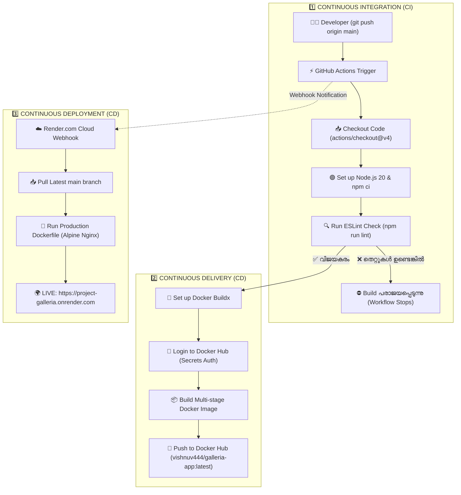

# 🔄 Project Galleria — CI/CD Complete Guide
### Continuous Integration (CI) • Continuous Delivery (CD) • Continuous Deployment (CD)

ഈ ഡോക്യുമെന്റേഷൻ **Project Galleria**-യിൽ CI/CD പ്രോസസ്സ് എങ്ങനെ പൂർണ്ണമായും പ്രവർത്തിക്കുന്നു എന്ന് വ്യക്തമായി വിശദീകരിക്കുന്നു.

---

## 1. എന്താണ് CI / CD? (ലളിതമായ അവലോകനം)

| പദം | അർത്ഥം | പ്രോജക്റ്റിൽ എന്ത് സംഭവിക്കുന്നു? |
| :--- | :--- | :--- |
| **CI (Continuous Integration)** | കോഡ് മാറ്റങ്ങൾ തുടർച്ചയായി പരിശോധിച്ച് സംയോജിപ്പിക്കുക | GitHub-ലേക്ക് push ചെയ്യുമ്പോൾ ESLint ടെസ്റ്റുകളും കോഡ് ക്വാളിറ്റി ചെക്കുകളും നടക്കുന്നു. |
| **CD (Continuous Delivery)** | പ്രൊഡക്ഷൻ-റെഡി പാക്കേജ് നിർമ്മിച്ച് സൂക്ഷിക്കുക | കോഡ് പാക്ക് ചെയ്ത് Docker Image ഉണ്ടാക്കി **Docker Hub**-ലേക്ക് റിലീസ് ചെയ്യുന്നു. |
| **CD (Continuous Deployment)** | മനുഷ്യ ഇടപെടലില്ലാതെ ലൈവ് സെർവറിലേക്ക് എത്തിക്കുക | പുതിയ ഇമേജ് യാതൊരു മാനുവൽ ക്ലിക്കും ഇല്ലാതെ **Render.com**-ൽ ലൈവ് ആക്കുന്നു. |

---

## 2. പൂർണ്ണ CI/CD വർക്ക്‌ഫ്ലോ ഡയഗ്രം



---

## 3. ഓരോ ഘട്ടവും പ്രവർത്തിക്കുന്ന രീതി (Step-by-Step)

### ഘട്ടം 1: Continuous Integration (CI)
* **ലക്ഷ്യം:** ഒരു ഡെവലപ്പർ പുതിയ കോഡ് എഴുതി പുഷ് ചെയ്യുമ്പോൾ, അതിൽ എന്തെങ്കിലും തെറ്റുകളോ (Syntax / Lint errors) ബഗുകളോ ഉണ്ടോ എന്ന് കമ്പ്യൂട്ടർ തനിയെ പരിശോധിക്കുന്നു.
* **നടക്കുന്ന ഫയൽ:** [.github/workflows/docker-publish.yml](file:///c:/Users/vishn/OneDrive/Desktop/galleria/.github/workflows/docker-publish.yml)
* **പ്രവർത്തന ഘട്ടങ്ങൾ:**
  1. `git push origin main` നടക്കുമ്പോൾ GitHub Actions വർക്ക്ഫ്ലോ ഓട്ടോമാറ്റിക്കായി ആരംഭിക്കുന്നു.
  2. ക്ലൗഡ് റണ്ണറിൽ Node.js 20 ഇൻസ്റ്റാൾ ചെയ്ത് ഡിപൻഡൻസികൾ ക്ലീനായി ഡൗൺലോഡ് ചെയ്യുന്നു (`npm ci`).
  3. `npm run lint` കമാൻഡ് പ്രവർത്തിച്ച് കോഡിലെ പ്രശ്നങ്ങൾ പരിശോധിക്കുന്നു.
  4. കോഡിൽ തെറ്റുണ്ടെങ്കിൽ വർക്ക്ഫ്ലോ അവിടെവെച്ച് തടയപ്പെടുന്നു (Docker Image നിർമ്മിക്കില്ല).

---

### ഘട്ടം 2: Continuous Delivery (CD) — Docker Image Build & Publish
* **ലക്ഷ്യം:** ടെസ്റ്റുകൾ പാസ്സായ പുതിയ കോഡിനെ, ഏത് സെർവറിലും പ്രവർത്തിപ്പിക്കാൻ പാകത്തിലുള്ള ഒരു **റിലീസ് ആർട്ടിഫാക്റ്റ് (Docker Image)** ആയി നിർമ്മിച്ച് **Docker Hub** രജിസ്ട്രിയിൽ സുരക്ഷിതമായി എത്തിക്കുക.
* **നടക്കുന്ന ഫയൽ:** [.github/workflows/docker-publish.yml](file:///c:/Users/vishn/OneDrive/Desktop/galleria/.github/workflows/docker-publish.yml)

#### 🛠️ Docker Image എങ്ങനെയാണ് ബിൽഡ് ചെയ്യുന്നത്? (Detailed Step-by-Step)

```text
Step 1: Buildx Engine Init ➡️ Step 2: Docker Hub Login ➡️ Step 3: Multi-Stage Build ➡️ Step 4: Registry Push
```

1. **Docker Buildx സജ്ജീകരിക്കൽ (`docker/setup-buildx-action@v3`):**
   - GitHub Actions റണ്ണറിൽ Docker-ന്റെ അത്യാധുനിക **BuildKit** എൻജിൻ തയ്യാറാക്കുന്നു.
   - ഇത് ഓരോ ലെയറും വേഗത്തിൽ കാഷെ (Cache) ചെയ്യാനും അതിവേഗത്തിൽ ബിൽഡ് പൂർത്തിയാക്കാനും സഹായിക്കുന്നു.

2. **Docker Hub ലോഗിൻ (`docker/login-action@v3`):**
   - GitHub Repository Secrets-ൽ നിങ്ങൾ നൽകിയിട്ടുള്ള `DOCKERHUB_USERNAME`, `DOCKERHUB_TOKEN` ഉപയോഗിച്ച് സെക്യൂർ ആയി ലോഗിൻ ചെയ്യുന്നു.

3. **Multi-Stage Dockerfile എക്സിക്യൂഷൻ (`docker/build-push-action@v5`):**
   [Dockerfile](file:///c:/Users/vishn/OneDrive/Desktop/galleria/Dockerfile) പ്രവർത്തിച്ച് ഇമേജ് രണ്ട് ഘട്ടങ്ങളിലായി (Multi-Stage) നിർമ്മിക്കുന്നു:

   * **ഘട്ടം A: Build Stage (`node:20-alpine AS build`)**
     - `FROM node:20-alpine`: ഭാരം കുറഞ്ഞ Node.js ലിനക്സ് എൻവയോൺമെന്റ് എടുക്കുന്നു.
     - `WORKDIR /app`: കണ്ടെയ്നറിനുള്ളിൽ `/app` ഫോൾഡർ ഉണ്ടാക്കുന്നു.
     - `COPY package*.json ./` & `RUN npm install`: കോഡിനാവശ്യമായ React, Vite ലൈബ്രറികൾ ഇൻസ്റ്റാൾ ചെയ്യുന്നു.
     - `COPY . .`: മുഴുവൻ സോഴ്സ് കോഡും കണ്ടെയ്നറിലേക്ക് പകർത്തുന്നു.
     - `RUN npm run build`: Vite പ്രൊഡക്ഷൻ ബിൽഡ് റൺ ചെയ്ത് മിനിഫൈ ചെയ്ത HTML, CSS, JavaScript ഫയലുകൾ `/app/dist`-ലേക്ക് മാറ്റുന്നു.

   * **ഘട്ടം B: Production Runtime Stage (`nginx:alpine`)**
     - `FROM nginx:alpine`: കേവലം ~20MB മാത്രം വലിപ്പമുള്ള അതിവേഗ Nginx വെബ് സെർവർ എടുക്കുന്നു.
     - `COPY --from=build /app/dist /usr/share/nginx/html`: Stage 1-ൽ ബിൽഡ് ചെയ്ത വെബ്സൈറ്റ് ഫയലുകൾ മാത്രം Nginx-ലേക്ക് കോപ്പി ചെയ്യുന്നു. (Node.js, devDependencies, node_modules എന്നിവ ഇവിടെ ഒഴിവാക്കുന്നു. ഇത് ഇമേജ് സൈസ് 500MB-ൽ നിന്ന് വെറും ~26MB ആയി ചുരുക്കുന്നു!).
     - `EXPOSE 80`: ട്രാഫിക്കിനായി Port 80 തുറക്കുന്നു.
     - `CMD ["nginx", "-g", "daemon off;"]`: കണ്ടെയ്നർ സ്റ്റോപ്പ് ആകാതെ Nginx സെർവർ റൺ ചെയ്യാൻ കമാൻഡ് നൽകുന്നു.

4. **Docker Hub-ലേക്ക് Push ചെയ്യൽ:**
   - ബിൽഡ് ചെയ്ത ലെയറുകൾ കംപ്രസ്സ് ചെയ്ത് **`${{ secrets.DOCKERHUB_USERNAME }}/galleria-app:latest`** എന്ന ടാഗോടെ Docker Hub-ലേക്ക് അപ്‌ലോഡ് ചെയ്യുന്നു.
   - ഇനി ഈ ഇമേജ് ലോകത്തെ ഏത് സെർവറിലും `docker run` വഴി നിമിഷങ്ങൾക്കകം റൺ ചെയ്യാൻ തയ്യാറാണ്.

---

### ഘട്ടം 3: Continuous Deployment (CD)
* **ലക്ഷ്യം:** മനുഷ്യന്റെ യാതൊരുവിധ ഇടപെടലുകളും ഇല്ലാതെ (Zero Human Intervention) കോഡ് തനിയെ പ്രൊഡക്ഷൻ ലൈവ് വെബ്സൈറ്റിൽ അപ്‌ഡേറ്റ് ചെയ്യപ്പെടുക.
* **പ്രവർത്തന ഘട്ടങ്ങൾ:**
  1. GitHub-ലേക്ക് push നടക്കുന്ന അതേ നിമിഷം തന്നെ Render.com-ലേക്ക് Webhook സിഗ്നൽ ലഭിക്കുന്നു.
  2. Render നിങ്ങളുടെ ഏറ്റവും പുതിയ കോഡ് പുൾ ചെയ്ത് [Dockerfile](file:///c:/Users/vishn/OneDrive/Desktop/galleria/Dockerfile) എക്സിക്യൂട്ട് ചെയ്യുന്നു.
  3. നിലവിൽ ഓടിക്കൊണ്ടിരിക്കുന്ന പഴയ കണ്ടെയ്നറിന് പകരം പുതിയ കണ്ടെയ്നർ ലൈവ് ആക്കുന്നു (Zero-downtime deployment).
  4. വെബ്സൈറ്റ് ലൈവ് ആകുന്നു: **https://project-galleria.onrender.com**

---

## 4. Continuous Delivery vs Continuous Deployment: പ്രധാന വ്യത്യാസം

```text
[Code] ➡️ [CI: Test] ➡️ [Build Docker Image] ➡️ [Docker Hub]
                                                    │
                   ┌────────────────────────────────┴────────────────────────────────┐
                   ▼                                                                 ▼
      Continuous Delivery (ഡെലിവറി)                               Continuous Deployment (ഡിപ്ലോയ്മെന്റ്)
   ഇമേജ് തയ്യാറാക്കി സൂക്ഷിക്കുന്നു.                               യാതൊരു ക്ലിക്കുമില്ലാതെ തനിയെ ലൈവ്
   എപ്പോൾ വേണമെങ്കിലും ഡിപ്ലോയ് ചെയ്യാം.                        സെർവറിലേക്ക് എത്തിക്കുന്നു (Render.com).
   (Ready to Deploy to Production)                              (Automatically Live in Production)
```

---

## 5. പ്രോജക്റ്റിൽ ഉൾപ്പെട്ടിരിക്കുന്ന കോൺഫിഗറേഷൻ ഫയലുകൾ

1. **[.github/workflows/docker-publish.yml](file:///c:/Users/vishn/OneDrive/Desktop/galleria/.github/workflows/docker-publish.yml):** CI ടെസ്റ്റുകളും Continuous Delivery (Docker Hub Publish) ഘട്ടങ്ങളും നിയന്ത്രിക്കുന്നു.
2. **[Dockerfile](file:///c:/Users/vishn/OneDrive/Desktop/galleria/Dockerfile):** React ആപ്പ് ബിൽഡ് ചെയ്ത് Nginx വെബ് സെർവറിൽ പാക്ക് ചെയ്യുന്ന കണ്ടെയ്നർ ബ്ലൂപ്രിന്റ്.
3. **[Render Cloud Webhook Service](https://dashboard.render.com):** GitHub-മായി കണക്ട് ചെയ്ത് Continuous Deployment സാധ്യമാക്കുന്ന ക്ലൗഡ് എൻജിൻ.
