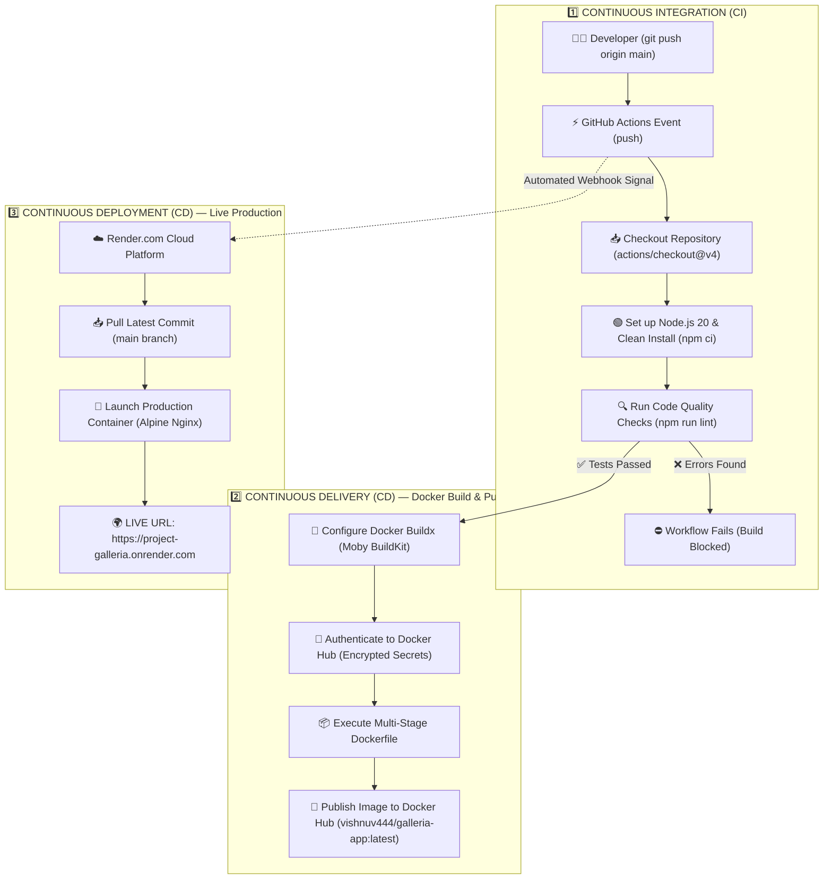

# 🔄 Project Galleria — Complete CI/CD Technical Documentation
### Continuous Integration (CI) • Continuous Delivery (CD) • Continuous Deployment (CD)

This document provides a comprehensive technical guide to the automated CI/CD pipeline powering **Project Galleria**, explaining every phase, tool, and Docker build step in detail.

---

## 1. What is CI/CD? (Concept Matrix)

| Concept | Purpose | Implementation in Project Galleria |
| :--- | :--- | :--- |
| **CI (Continuous Integration)** | Automatically test and validate every code change on commit | Runs on GitHub Actions: Installs dependencies (`npm ci`) and executes ESLint quality checks (`npm run lint`). |
| **CD (Continuous Delivery)** | Automatically build, package, and release production-ready artifacts | Builds a multi-stage Docker image via **Docker Buildx** and pushes it to **Docker Hub** registry. |
| **CD (Continuous Deployment)** | Automatically deploy validated code to live production servers with zero human touch | **Render.com** receives a webhook from GitHub, builds/pulls the container, and serves it live at [https://project-galleria.onrender.com](https://project-galleria.onrender.com). |

---

## 2. End-to-End Architectural Pipeline



---

## 3. Phase-by-Phase Technical Breakdown

### Phase 1: Continuous Integration (CI) — Quality Gate
* **Objective:** Ensure all code pushed by developers is free of syntax issues, lint errors, or broken dependencies before building container images.
* **Workflow File:** [.github/workflows/docker-publish.yml](file:///c:/Users/vishn/OneDrive/Desktop/galleria/.github/workflows/docker-publish.yml)
* **Execution Steps:**
  1. **Event Trigger:** Developer runs `git push origin main`. GitHub detects the push event on the `main` branch.
  2. **Runner Provisioning:** GitHub spins up an isolated Ubuntu virtual machine (`runs-on: ubuntu-latest`).
  3. **Repository Checkout:** `actions/checkout@v4` downloads the source code into the runner workspace.
  4. **Node.js 20 Setup:** `actions/setup-node@v4` initializes Node.js runtime and configures npm caching for fast installations.
  5. **Clean Dependency Install:** `npm ci` installs exact dependency versions defined in `package-lock.json`.
  6. **Static Code Analysis:** `npm run lint` executes ESLint across all JSX and JavaScript files. If any error is found, the workflow halts immediately, preventing broken code from progressing to the build phase.

---

### Phase 2: Continuous Delivery (CD) — Deep-Dive Docker Image Build & Publish
* **Objective:** Package the validated React application into an optimized, secure, standalone container image and deliver it to the **Docker Hub** registry.
* **Workflow Steps:**

#### 1. Docker Buildx Engine Initialization (`docker/setup-buildx-action@v3`)
- Initializes Docker's **BuildKit** engine on the GitHub runner.
- BuildKit provides advanced layer caching, parallel step execution, and multi-platform build capabilities.

#### 2. Registry Authentication (`docker/login-action@v3`)
- Authenticates securely with Docker Hub using encrypted repository secrets:
  - `secrets.DOCKERHUB_USERNAME`
  - `secrets.DOCKERHUB_TOKEN`
- Avoids exposing credentials in plaintext logs.

#### 3. Multi-Stage Dockerfile Compilation (`docker/build-push-action@v5`)
The build engine executes [Dockerfile](file:///c:/Users/vishn/OneDrive/Desktop/galleria/Dockerfile) using a **two-stage architecture**:

```text
[Stage 1: node:20-alpine]                 [Stage 2: nginx:alpine]
 ├── Install npm dependencies             ├── Lightweight Nginx Web Server (~20MB)
 ├── Compile JSX & Vite Assets            ├── Copies ONLY /app/dist static files
 └── Generates /app/dist folder ────────> └── Exposes Port 80 & Serves Web Traffic
                                          (Node.js & node_modules are discarded!)
```

* **Stage 1 — Build Stage (`node:20-alpine AS build`):**
  1. `FROM node:20-alpine AS build`: Pulls a minimal Alpine Linux image containing Node.js 20.
  2. `WORKDIR /app`: Creates the working directory inside the container.
  3. `COPY package*.json ./` & `RUN npm install`: Installs required React and Vite dependencies.
  4. `COPY . .`: Copies the full source code into the container.
  5. `RUN npm run build`: Vite bundles JSX modules, minifies CSS, splits JS chunks, and generates the production-ready distribution inside `/app/dist`.

* **Stage 2 — Production Runtime Stage (`nginx:alpine`):**
  1. `FROM nginx:alpine`: Pulls an ultra-lightweight Nginx web server image (~20MB).
  2. `COPY --from=build /app/dist /usr/share/nginx/html`: Copies **only** the compiled static files from Stage 1 into Nginx's document root.
  3. **Why Multi-Stage?** All Node.js binaries, npm build tools, and heavy `node_modules` are completely discarded. This slashes image size from **~500 MB+ down to just ~26.4 MB**, boosting security and transfer speed.
  4. `EXPOSE 80`: Exposes HTTP port 80.
  5. `CMD ["nginx", "-g", "daemon off;"]`: Runs Nginx in the foreground so the container remains active.

#### 4. Publishing to Docker Hub
- The compiled layers are compressed and published to Docker Hub under the tag:
  ```text
  vishnuv444/galleria-app:latest
  ```
- Any server or developer worldwide can now pull and run the application with:
  ```bash
  docker run -d -p 8080:80 vishnuv444/galleria-app:latest
  ```

---

### Phase 3: Continuous Deployment (CD) — Zero-Touch Live Production
* **Objective:** Deploy changes directly to the live production environment without manual intervention.
* **Platform:** [Render.com](https://render.com)
* **Execution Flow:**
  1. **Webhook Notification:** As soon as code is pushed to the `main` branch, GitHub sends an automated webhook to Render.
  2. **Automated Pull & Build:** Render's cloud worker pulls the latest commit from `project-galleria` and executes `Dockerfile`.
  3. **Zero-Downtime Rolling Update:** Render boots the new Nginx container, runs a health check, and seamlessly shifts traffic from the old container to the new one.
  4. **Live Production URL:** The application is instantly available globally at:
     👉 **[https://project-galleria.onrender.com](https://project-galleria.onrender.com)**

---

## 4. Continuous Delivery vs Continuous Deployment: The Difference

```text
                        ┌─────────────────────────────────────────────────────────┐
                        │             Developer commits code to GitHub            │
                        └────────────────────────────┬────────────────────────────┘
                                                     ▼
                        ┌─────────────────────────────────────────────────────────┐
                        │              Continuous Integration (CI)                │
                        │           Automated ESLint & Build Validation           │
                        └────────────────────────────┬────────────────────────────┘
                                                     ▼
                        ┌─────────────────────────────────────────────────────────┐
                        │           Build Multi-Stage Docker Container            │
                        └────────────────────────────┬────────────────────────────┘
                                                     ▼
                        ┌─────────────────────────────────────────────────────────┐
                        │               Push to Docker Hub Registry               │
                        └────────────────────────────┬────────────────────────────┘
                                                     │
                   ┌─────────────────────────────────┴─────────────────────────────────┐
                   ▼                                                                   ▼
       Continuous Delivery (CD)                                            Continuous Deployment (CD)
  Image is securely packaged and stored                               Changes go automatically live to users
  in Docker Hub. Ready to be deployed                                 on Render.com without any manual action
  to any cloud server at any time.                                    (100% Zero-Touch Automation).
```

---

## 5. Summary of Pipeline Configuration Files

1. **[.github/workflows/docker-publish.yml](file:///c:/Users/vishn/OneDrive/Desktop/galleria/.github/workflows/docker-publish.yml):** Orchestrates CI lint checks, Buildx configuration, Docker Hub login, and multi-stage image publishing.
2. **[Dockerfile](file:///c:/Users/vishn/OneDrive/Desktop/galleria/Dockerfile):** Defines the two-stage build process (Node.js 20 build ➡️ Nginx Alpine runtime).
3. **[.dockerignore](file:///c:/Users/vishn/OneDrive/Desktop/galleria/.dockerignore):** Excludes `node_modules`, `.git`, and local build artifacts from being sent to the Docker daemon.
4. **[Render Cloud Web Service](https://dashboard.render.com):** Manages live production hosting with automated Git-driven deployments.
