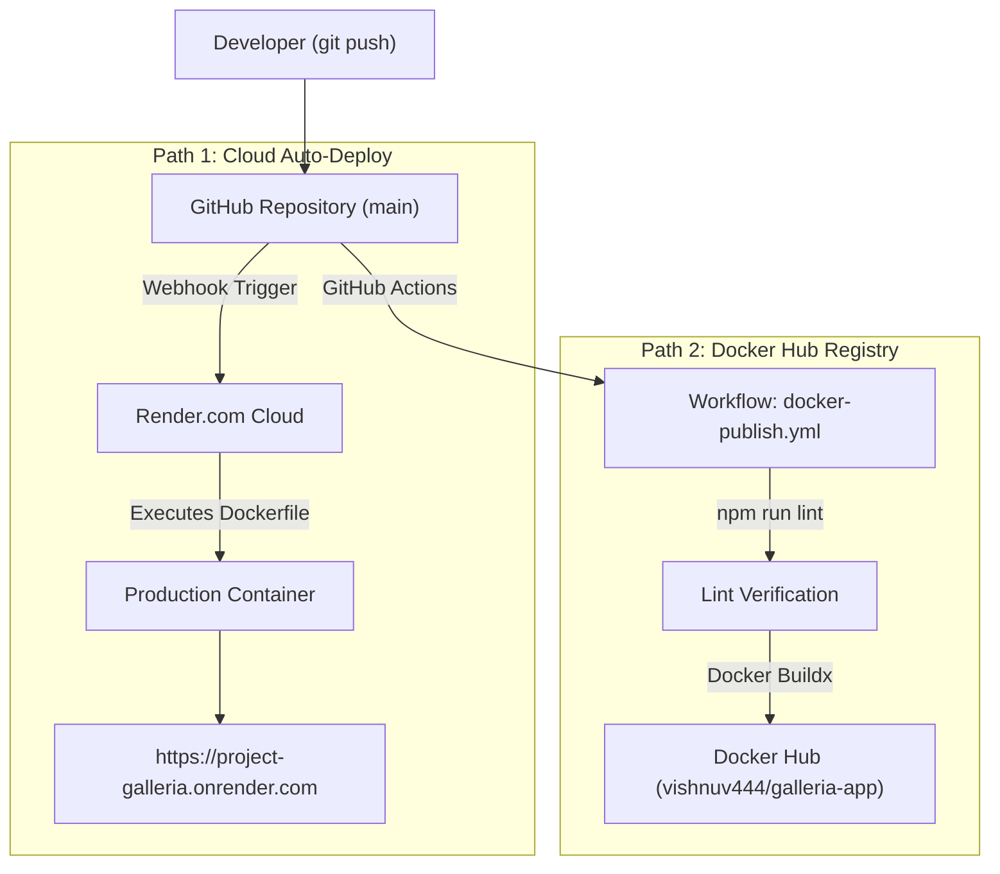

# 💎 Project Galleria — Developer Documentation

Welcome to the **Project Galleria** developer documentation. This document provides a complete technical reference for developers maintaining, extending, or deploying the application.

---

## 1. Project Overview & Architecture

**Project Galleria** is an ultra-modern, high-performance web portfolio and interactive digital showcase built for Vishnu. It features glassmorphism UI aesthetics, dynamic theme switching (Clean Minimalist Light Mode & Cyber Dark Mode), interactive micro-animations, and a cloud-native containerized architecture.

### 🛠️ Technology Stack

| Layer | Technology | Version | Purpose |
| :--- | :--- | :--- | :--- |
| **Frontend Framework** | React | `^19.2.8` | Component state management & UI rendering |
| **Build Tool & Bundler** | Vite | `^8.3.0` | Ultra-fast HMR and optimized production bundling |
| **Styling** | Vanilla CSS | CSS3 | Custom Glassmorphism design system & CSS variables |
| **Code Quality** | ESLint | `^10.10.0` | Static analysis & React Hook linting |
| **Containerization** | Docker | Multi-stage | Alpine Node build & Alpine Nginx web server |
| **CI / CD** | GitHub Actions | v4 / v5 actions | Automated linting, Docker build & Docker Hub push |
| **Cloud Hosting** | Render.com | Free Web Service | Zero-touch continuous deployment via Git integration |

---

## 2. Directory Structure

```text
galleria/
├── .github/
│   └── workflows/
│       ├── docker-publish.yml     # Automated CI/CD pipeline for Docker Hub
│       └── main.yml.disabled      # Legacy workflow backup
├── public/
│   └── favicon.svg                # Application icon
├── src/
│   ├── assets/                    # Static assets & images
│   ├── components/
│   │   ├── Test.jsx               # Primary Galleria portfolio showcase component
│   │   └── Test.css               # Comprehensive Glassmorphism & Theme CSS
│   ├── App.jsx                    # Root application component
│   ├── App.css                    # Supplementary layout styling
│   ├── index.css                  # Global CSS tokens, reset, & body background
│   └── main.jsx                   # React 19 DOM mount root
├── Dockerfile                     # Multi-stage production container build
├── .dockerignore                  # Files excluded from Docker build context
├── eslint.config.js               # ESLint configuration rules
├── index.html                     # HTML5 entry template & font imports
├── package.json                   # Project dependencies and npm scripts
└── vite.config.js                 # Vite bundler configuration
```

---

## 3. Core Features & Implementation Details

### 🎨 Theme System (Light & Dark)
The application defaults to a **Clean Minimalist Light Mode** (`#f8fafc`) with support for a **Cyber Dark Mode** (`#07080d`).
- **State Management:** Handled in `Test.jsx` via the `theme` React state.
- **Dynamic DOM Sync:** Toggling updates the outer wrapper class (`theme-light` vs `theme-dark`) and synchronizes `document.body.style.backgroundColor`.
- **CSS Variables:** Colors, orbs, glass cards, text contrast, and borders adapt dynamically using CSS tokens defined in `src/components/Test.css`.

### 🔮 Interactive Components
1. **Live Magic Spark Counter:** Interactive state tracking developer engagement with celebratory toast alerts.
2. **Category Filter System:** Filter projects by `All`, `Web Apps`, `3D & Visuals`, and `UI Concepts`.
3. **Reactive Like Counter:** Per-card reactive like incrementer with event propagation protection (`e.stopPropagation()`).
4. **Ambient Orb Animations:** Pure CSS radial gradient floating light spheres with GPU-accelerated keyframe float animations.

---

## 4. Local Development Workflow

### Prerequisites
- **Node.js**: v20 or higher
- **npm**: v10 or higher
- **Docker Desktop**: Recommended for container testing

### Setup & Run

```bash
# 1. Install dependencies cleanly
npm install

# 2. Start Vite local development server with HMR
npm run dev

# 3. Check code quality and linting rules
npm run lint

# 4. Generate production build bundle
npm run build

# 5. Preview the production build locally
npm run preview
```

---

## 5. Docker Containerization Guide

The project utilizes a **two-stage Dockerfile** designed to optimize container image size and security.

### Dockerfile Architecture
1. **Build Stage (`node:20-alpine AS build`):**
   - Installs dependencies cleanly.
   - Runs `npm run build` to compile the React app into static HTML, CSS, and JS files inside `/app/dist`.
2. **Production Stage (`nginx:alpine`):**
   - Discards all Node.js and build dependencies.
   - Copies only the `/app/dist` static assets into `/usr/share/nginx/html`.
   - Exposes port `80` and starts Nginx as a non-daemon foreground service.
   - **Total Image Size:** Compressed to ~26.4 MB content size (~93.9 MB disk footprint).

### Docker Commands

```bash
# Build the Docker image locally
docker build -t vishnuv444/galleria-app:latest .

# Run the container locally on Port 8080
docker run -d -p 8080:80 --name my-galleria vishnuv444/galleria-app:latest

# View container runtime logs
docker logs my-galleria

# Stop and remove the container
docker rm -f my-galleria
```

---

## 6. Automated CI/CD & Deployment Pipeline

The project supports two continuous delivery avenues:



### 1. Render Cloud Deployment (Live Production)
- **Live URL:** [https://project-galleria.onrender.com](https://project-galleria.onrender.com)
- **Deployment Mechanism:** Connected directly to the GitHub repository. Whenever code is pushed to `main`, Render's build worker pulls the repo, executes `Dockerfile`, and replaces the live container with zero downtime.

### 2. GitHub Actions (`.github/workflows/docker-publish.yml`)
- Triggered automatically on pushes to `main`.
- **Steps:**
  1. Checks out repository source code.
  2. Sets up Node.js 20 and installs dependencies (`npm ci`).
  3. Executes ESLint quality gate (`npm run lint`).
  4. Configures Docker Buildx.
  5. Authenticates to Docker Hub using GitHub repository secrets:
     - `DOCKERHUB_USERNAME`
     - `DOCKERHUB_TOKEN`
  6. Builds and publishes the multi-platform image to `vishnuv444/galleria-app:latest`.

---

## 7. Adding New Projects to the Galleria

To add new items to the portfolio showcase, edit `INITIAL_PROJECTS` in [src/components/Test.jsx](file:///c:/Users/vishn/OneDrive/Desktop/galleria/src/components/Test.jsx):

```javascript
{
  id: 7,
  title: 'Your Project Title',
  category: 'Web Apps', // Options: 'Web Apps', '3D & Visuals', 'UI Concepts'
  desc: 'A concise summary of what makes this project special.',
  tags: ['React', 'Next.js', 'Tailwind'],
  likes: 10,
  gradient: 'linear-gradient(135deg, #6366f1 0%, #06b6d4 100%)',
  icon: '🚀'
}
```

Once saved:
```bash
git add .
git commit -m "feat: add new showcase project"
git push origin main
```
The automated CI/CD pipeline will automatically build and publish the updates to production!
